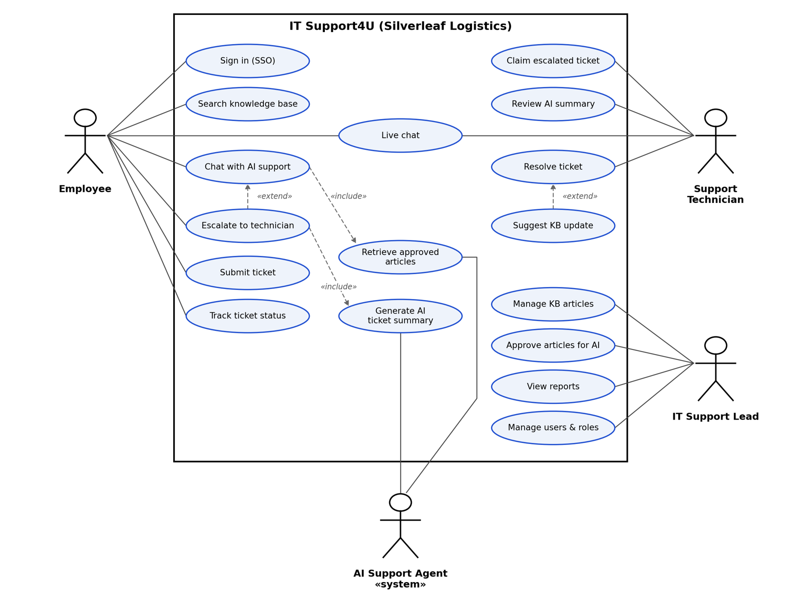

# ⭐ IT Support4U: AI-Assisted IT Help Desk (Senior Capstone)

**Course:** Senior Capstone Project (IT 5003C) · **Timeline:** Fall 2026 – Spring 2027 · **Team:** 5 members · **My role:** Project Lead / UI/UX / Documentation

> **Status: In progress.** Design and planning are complete, and development is underway. Final presentation is in March 2027, followed by the IT Expo in April 2027.

## The Problem
IT help desks spend much of their day on repetitive, low-complexity requests like password resets, MFA lockouts, and VPN issues. Users wait in long queues for fixes that are already documented, and tier-one technicians lose time they could spend on complex incidents.

## The Solution
IT Support4U is a web application that puts an AI support agent in front of the help desk:
1. A user describes their problem in plain, nontechnical language.
2. The AI agent searches an **approved knowledge base** and walks the user through step-by-step troubleshooting.
3. If the fix doesn't work, or no approved article exists, the user escalates with one tap. The AI generates a **ticket summary** with the steps already tried, so the user never has to repeat themselves.
4. A technician claims the ticket, reviews the summary, and resolves the issue through live chat.
5. The technician can suggest a knowledge base update, and once the support lead approves it, the AI can solve that issue on its own next time.

The prototype is built around a fictional company, **Silverleaf Logistics**, so it can be demonstrated to any organization.

## My Role
As **Project Lead**, I coordinate the team, organize requirements, and manage our team contract and documentation. On the design side, I lead **UI/UX design**, including Figma wireframes and prototypes for both the employee portal and the technician console. In our design report, I wrote the **user personas** and the **use case model**.

## Use Case Model

## User Personas
I created four personas to guide the design of each screen:
- **Kevin, Warehouse Shift Supervisor:** Works nights when the help desk is closed and mostly uses his phone. He needs fast, mobile-friendly help, for example after an MFA lockout.
- **Nadia, Account Manager:** Hybrid worker whose VPN keeps dropping. She tries the AI first, escalates when needed, and wants to track her ticket without repeating her problem.
- **Rachel, Tier-One Technician:** Picks up escalated tickets and needs the AI summary and attempted steps up front so she can start where the AI left off.
- **Andre, IT Support Lead:** Owns the knowledge base, approves which articles the AI can use, and tracks AI-resolved vs. escalated tickets.

## Technical Architecture
| Component | Technologies |
|---|---|
| Frontend | React, HTML, CSS, JavaScript |
| Backend API | Python, FastAPI |
| Database | PostgreSQL / MySQL |
| AI support component | LLM API, restricted to approved knowledge base articles |
| Authentication & security | SSO (Microsoft Entra ID / Auth0), role-based access, input validation |
| Testing | FastAPI Swagger, scenario testing, usability testing |
| Hosting & version control | Azure / AWS, GitHub |

**Security and ethics built into the design:** role-based access (employees can't see the support queue, technicians can't approve AI articles), an AI limited to approved content so it hands off to a human instead of guessing, and accessibility guided by WCAG 2.1 and the OWASP Top 10.

## Success Measures
- Usability testing with **5–10 students and faculty**
- At least **70% of testers** complete guided troubleshooting without help
- Tracking AI-resolved vs. escalated tickets
- Deployed and accessible from a normal browser

## Project Timeline
| Phase | Dates | Status |
|---|---|---|
| System design & wireframing | Sep – Oct 2026 | ✅ Complete |
| Development phase 1 | Oct – Nov 2026 | 🔄 In progress |
| Development phase 2 | Dec 2026 – Jan 2027 | ⏳ Upcoming |
| Testing & debugging | Jan – Feb 2027 | ⏳ Upcoming |
| Final presentation | Mar 2027 | ⏳ Upcoming |
| IT Expo | Apr 2027 | ⏳ Upcoming |

---
_IT Support4U is a team project. This page describes the overall project and highlights my contributions as project lead and UI/UX designer._
