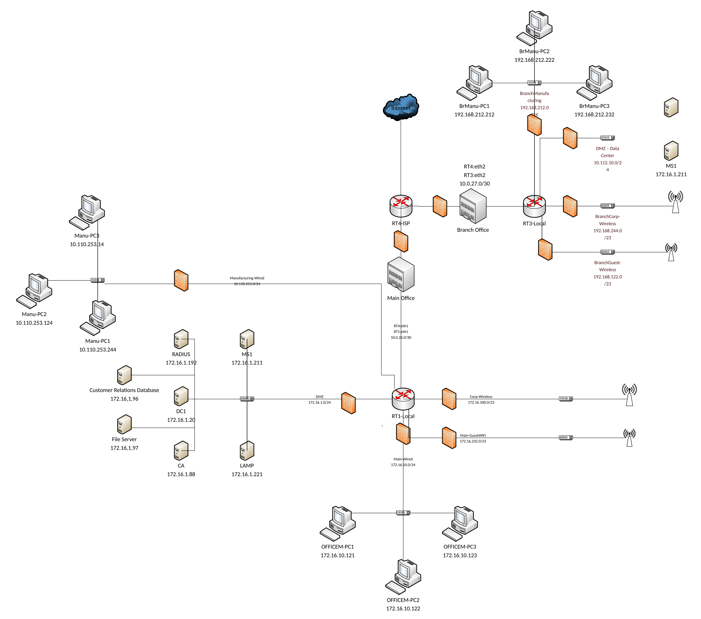

# Network Risk Assessment & Secure Expansion Plan

**Course:** Network Security (IT 3071C) · **Term:** Summer 2025 · **Type:** Group project (4 members)

## Overview
Our team acted as security consultants for a small manufacturing company. In **Part 1**, we assessed the company's existing network, identified risks and vulnerabilities, and documented a mitigation plan for each one. In **Part 2**, we designed a secure network for the company's one-year growth plan and wrote prioritized security recommendations for its board of directors, along with a new logical network diagram.

## Part 1: Risk Assessment
For each risk we documented the vulnerability, the affected systems, the business impact, and the fix (a policy, a security control, or a configuration change).

| Risk | Affected Systems | Potential Impact | Mitigation |
|---|---|---|---|
| **Unsupported operating system:** manufacturing PCs still run Windows 7, which no longer receives security patches | Manufacturing systems and everything connected to them | Attackers exploit known vulnerabilities to halt production or pivot into the wider network | Isolate on a dedicated VLAN behind a firewall, disable unused services and ports, add endpoint protection, and virtualize if Windows 7 must stay |
| **Flat network:** office PCs, servers, and manufacturing systems all share one network | The entire organization | Malware or an attacker moves laterally and spreads quickly | A Network Segmentation Policy requiring VLANs, firewall rules between segments, access controls, and regular compliance checks |
| **Unprotected public website:** the web server is exposed directly to the internet with no WAF or reverse proxy | The website and its visitors | Customer data theft, defacement, or attacks launched against visitors | A Web Server Security Policy requiring a WAF and reverse proxy, regular vulnerability scans, hardened Apache/MySQL/PHP settings, and timely patching |

## Part 2: Secure Expansion Plan
The company's roadmap included a second office, online orders and payments tied to a customer database, a partner extranet, remote workers, a new SCADA/IoT manufacturing system, and Wi-Fi in both offices. We designed a segmented network to support all of it securely.

**Network design highlights:** two sites linked by a dedicated router-to-router connection, with separate firewalled segments at each site for wired office users, corporate Wi-Fi, guest Wi-Fi, manufacturing systems, and servers.

### Security Recommendations
1. **Secure remote access with VPN and MFA:** a site-to-site VPN between offices, a remote-access VPN for employees, and multi-factor authentication for all outside access, with firewall rules limiting VPN users to only the systems they need.
2. **DMZ for public web services:** move the website and order system into a dedicated DMZ protected by a web application firewall, reverse proxy, TLS, IDS/IPS monitoring, and a firewall between the DMZ and internal servers, since the site will now handle customer payment data.
3. **Isolated extranet for supply chain partners:** a dedicated zone with authenticated, encrypted, and logged access, strict ACLs, least-privilege permissions, and data loss prevention (DLP) where sensitive data is exposed.
4. **Isolated SCADA/IoT network:** segment operational technology behind an industrial-grade firewall with least-privilege rules, add IDS/IPS and SIEM monitoring, enforce physical security and network access control (NAC), and keep offsite backups for recovery.
5. **Segmented, secure Wi-Fi:** run a site survey, then separate corporate and guest wireless networks. Corporate Wi-Fi uses WPA3-Enterprise with RADIUS, certificate-based NAC with security posture checks, and web filtering. Guest Wi-Fi uses WPA3 with a captive portal and no access to corporate traffic.

## What I Learned
- How to run a risk assessment: identify the vulnerability, the affected assets, and the business impact, then choose the right type of control.
- How to write security recommendations for executives, explaining the business need instead of just the technology.
- How network segmentation, DMZs, and least-privilege access work together as defense in depth.
- How to secure environments with special requirements, like OT/SCADA systems and partner access.

---
_The company and network are fictional, provided as a course scenario. This was a team project completed by four students._
