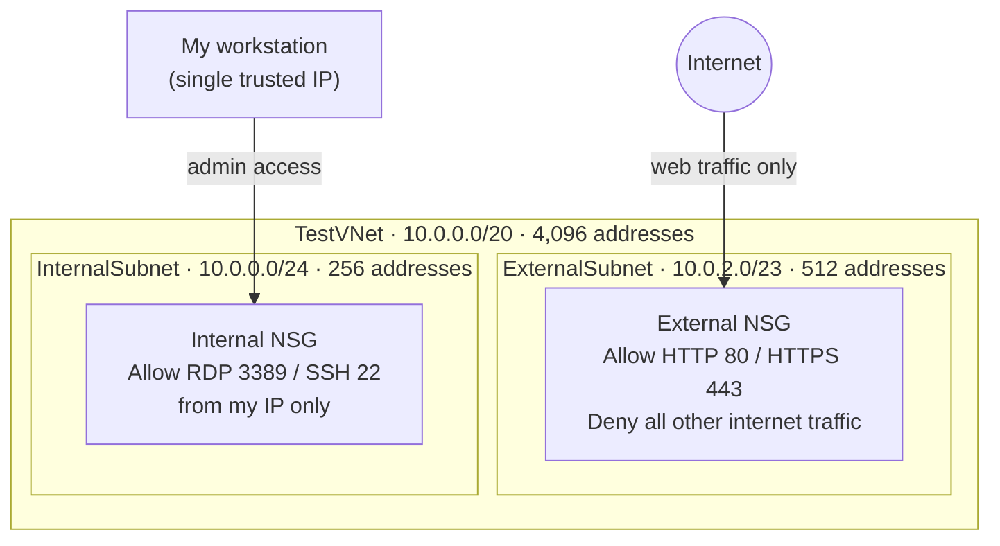
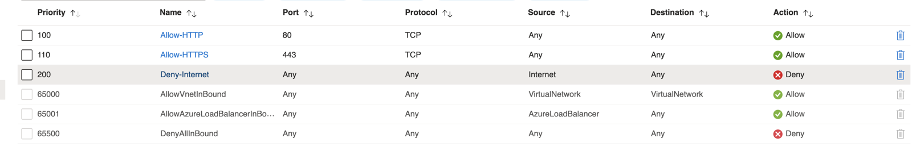
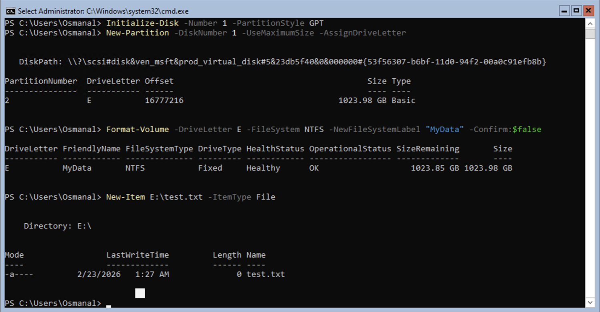
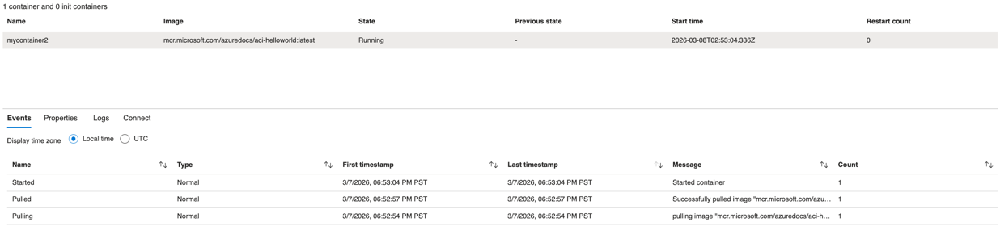

# Azure Cloud Fundamentals: Governance, Networking, Storage & Compute

**Course:** Cloud Computing (IT 3037C) · **Term:** Spring 2026 · **Type:** Individual labs (combined)

## Overview
This project brings together four Microsoft Azure labs that cover the core building blocks of a cloud environment: **governance** with PowerShell, **secure networking** with VNets and network security groups, **storage** (managed disks, blob storage, and file shares), and **compute** with web apps and containers. Together with my [AWS asset management project](../snipe-it-asset-management-aws), it shows hands-on experience in both major cloud platforms.

## Tools & Technologies
Microsoft Azure · Azure PowerShell & Cloud Shell · Virtual Networks · Network Security Groups · Managed Disks · Blob Storage · Azure Files · Static Web Apps · Azure Container Instances · GitHub Actions

---

## 1. Cloud Governance with PowerShell
Using Azure Cloud Shell, I managed a resource group entirely from PowerShell.

**Tagged the resource group** for organization and cost tracking:
```powershell
$tags = @{
    "University" = "University of Cincinnati"
    "Degree"     = "Information Technology"
    "Course"     = "Cloud Computing"
}
$resourceGroup = Get-AzResourceGroup -Name "TestResourceGroup"
New-AzTag -ResourceId $resourceGroup.ResourceId -Tag $tags
```

**Audited who has access:**
```powershell
Get-AzRoleAssignment -ResourceGroupName TestResourceGroup | FL DisplayName, RoleDefinitionName
```

**Pulled 21 days of activity logs:**
```powershell
Get-AzLog -ResourceGroupName "TestResourceGroup" -StartTime (Get-Date).AddDays(-21)
```

**Findings:**
- **Tags** make it easy to see who owns a resource, what it's for, and which project to bill, which is essential for budgeting in large environments.
- **Access review:** the resource group had many users with the **Owner** role, because the university's administrators inherit it from the subscription. In a company, that many owners raises the risk of accidental or unauthorized changes and makes accountability harder, a clear **least-privilege** concern.
- **Activity logs** record who did what and when, supporting incident investigations, change tracking, and audit and compliance requirements.

---

## 2. Secure Virtual Network Design
I designed a VNet sized for growth, with separate internal and external subnets, each protected by its own network security group (NSG).



| Subnet | Purpose | NSG rules |
|---|---|---|
| Internal (`10.0.0.0/24`) | Administrative and internal workloads | Allow RDP (3389) and SSH (22) **from my public IP only** |
| External (`10.0.2.0/23`) | Public-facing workloads | Allow HTTP (80) and HTTPS (443); **deny all other internet traffic** |

External NSG rules as configured in Azure:



**Why it matters:** restricting admin protocols to a single trusted IP blocks the brute-force attacks constantly aimed at open RDP and SSH ports, while the external subnet exposes only the web ports a public site actually needs.

**VPN vs. ExpressRoute:** a VPN connects to Azure through an encrypted tunnel over the public internet and is cost-effective for smaller or flexible workloads. ExpressRoute is a private, dedicated connection that offers higher performance and reliability for large enterprise or production environments.

---

## 3. Cloud Storage
I deployed and tested three types of Azure storage:
- **Managed disk:** attached a data disk to a Windows Server VM, then initialized, partitioned, and formatted it with PowerShell and confirmed it was writable.
- **Blob storage:** created a general-purpose v2 storage account and container, uploaded a file, and confirmed it was reachable from a browser through its public URL.
- **Azure Files:** created a file share with a 5 GB quota and attempted to mount it from my local machine over SMB.



---

## 4. Web Apps & Containers
- **Static Web App:** deployed a static website to Azure App Service on the Free tier, with deployment handled through a **GitHub Actions** workflow.
- **Container Instance:** deployed a container from Microsoft's container registry and confirmed it was pulled, started, and running.



**Choosing a compute option:** web apps are the simplest to run because Azure handles updates, scaling, and maintenance. Containers package an app with its dependencies so it runs the same anywhere. Virtual machines give the most control but leave patching, configuration, and security to the administrator.

---

## Troubleshooting & Lessons Learned
- **File share wouldn't mount locally:** my SMB connection to the Azure file share failed. A common cause is that many home internet providers block SMB port 445, which is why organizations often use a VPN or Azure File Sync to reach file shares.
- **Protecting access keys:** mounting a file share with a storage account key exposes a credential that grants full access to the account. In production I would keep keys out of command history and screenshots, rotate them regularly, and prefer identity-based access or short-lived SAS tokens.
- **Public blob access:** the lab required anonymous read access on the blob container. In a real environment, containers should be private by default, with access granted through SAS tokens or role-based access.

## What I Learned
- How to manage cloud resources from the command line with PowerShell
- How to plan IP address space and subnets for a cloud network
- How to write NSG rules that enforce least-privilege network access
- How tagging, access reviews, and activity logs support cost control, security, and compliance
- The trade-offs between web apps, containers, and virtual machines

---
_All resources were deployed in a student Azure subscription for coursework._
