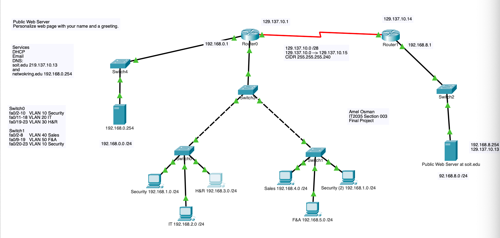
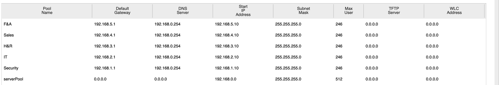

# Enterprise Network Build: VLANs, EIGRP, NAT, DHCP & Services

**Course:** Network Infrastructure Management (IT 2035C) · **Term:** Spring 2025 · **Type:** Individual final project · **Tool:** Cisco Packet Tracer

## Overview
For my final project, I built a complete two-network enterprise environment in Cisco Packet Tracer. A private corporate network with five departmental VLANs and a services server connects across a WAN link to a separate network hosting a public web server. Hosts on the private network get their addresses automatically, send email, resolve domain names, and browse the public website, all through routing and NAT that I configured.

## Tools & Technologies
Cisco Packet Tracer · Cisco IOS · EIGRP · VLANs & 802.1Q trunking · Static NAT · Dynamic NAT/PAT · DHCP · DNS · SMTP/POP3 email · HTTP

## Network Topology

📁 **[Download the Packet Tracer file](./network-topology.pkt)** (requires Cisco Packet Tracer 8.2.1 or later)

| Segment | Network | Purpose |
|---|---|---|
| VLAN 10 – Security | 192.168.1.0/24 | Department hosts (on both access switches) |
| VLAN 20 – IT | 192.168.2.0/24 | Department hosts |
| VLAN 30 – H&R | 192.168.3.0/24 | Department hosts |
| VLAN 40 – Sales | 192.168.4.0/24 | Department hosts |
| VLAN 50 – F&A | 192.168.5.0/24 | Department hosts |
| Services | 192.168.0.0/24 | DHCP, DNS, and email server |
| WAN link | 129.137.10.0/28 | Public addressing between the two routers |
| Public web network | 192.168.8.0/24 | Public web server for `soit.edu` |

## What I Did
- **VLANs and trunking:** created five departmental VLANs, assigned switch port ranges to each, and configured trunk links so VLAN traffic could travel between switches and up to the router.
- **Dynamic routing:** configured **EIGRP** on both routers so the private network and the public web network learn each other's routes automatically.
- **Static NAT:** mapped the public web server's private address (192.168.8.254) to a public address (129.137.10.13) so it's reachable from outside its network.
- **Dynamic NAT with overload (PAT):** used an access list and a pool of public addresses so every internal host can share a small range of public IPs when leaving the private network.
- **DHCP:** built a separate address pool for each VLAN, with the correct default gateway and DNS server, so every PC configures itself automatically.
- **DNS:** created records for `soit.edu` (the public web server) and `networking.edu` (the internal services server).
- **Email:** configured SMTP and POP3 services and set up mail clients to send and receive messages between users.
- **Web:** customized the public web server's homepage with HTML.

## Results
**DHCP pools:** one per department, each handing out the right gateway and DNS server:

**End-to-end test:** a PC in the Sales VLAN loading the public website by name. This one request proves DHCP, DNS, inter-VLAN routing, EIGRP, and NAT are all working together:

I also confirmed that PCs received their full IP configuration through DHCP, and that email sent through the server was delivered and received over POP3.

## What I Learned
- How VLANs segment a network by department and how trunking carries multiple VLANs over one link
- How EIGRP shares routes between networks without manual static routes
- The difference between static NAT (one-to-one, for servers) and PAT (many-to-one, for users)
- How DHCP, DNS, routing, and NAT depend on each other, and how to verify a network end to end
- How to build and troubleshoot a complete network from an empty topology to working services

---
_Built in a simulated Cisco Packet Tracer environment for coursework._
