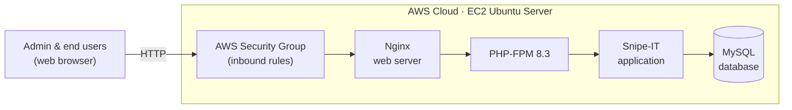
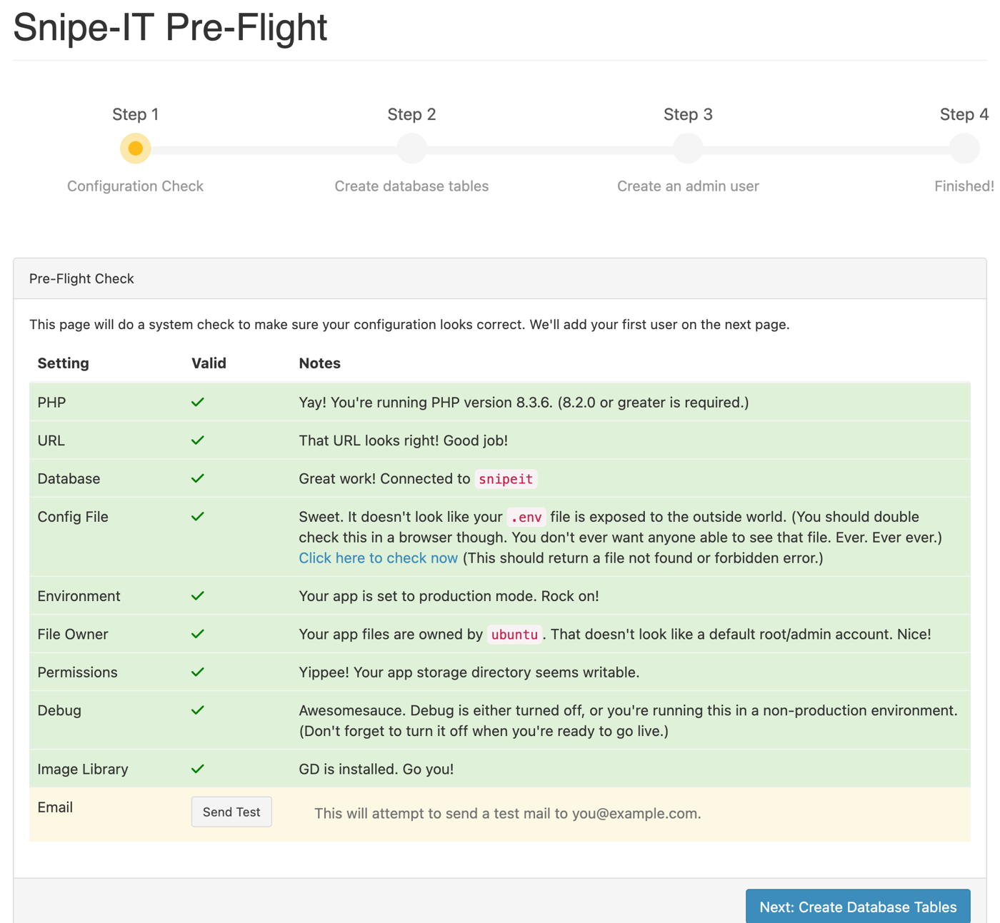
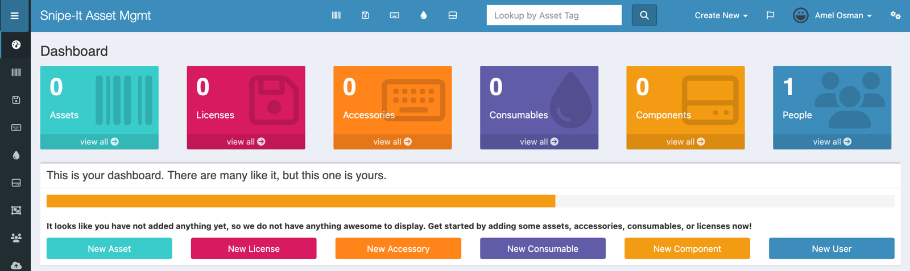

# IT Asset Management Server on AWS (Snipe-IT)

**Course:** Enterprise Systems Administration (IT 3036C) · **Term:** Summer 2025 · **Type:** Individual final project

## Overview
For my final project, I proposed and built a working IT asset management system in the cloud. I deployed **Snipe-IT**, an open-source asset management platform, on an **AWS EC2** Ubuntu server, configuring the full web stack myself: Nginx, PHP-FPM, MySQL, and Composer.

Asset management tracks every laptop, server, and software license an organization owns: who has it, where it is, and when it needs to be audited or replaced. An accurate inventory is the foundation for patching, audits, and supply chain risk management (NIST SP 800-161), because you can't secure or assess assets you don't know you have.

## Tools & Technologies
AWS EC2 (Free Tier) · Ubuntu Server · Nginx · PHP 8.3 / PHP-FPM · MySQL · Composer · Snipe-IT · AWS Security Groups

## Architecture

## What I Did
1. **Launched the server:** Created an Ubuntu EC2 instance on the AWS Free Tier and configured its security group to allow web and administrative access.
2. **Built the web stack:** Installed and configured PHP, MySQL, Composer, and Nginx.
3. **Deployed the application:** Downloaded Snipe-IT, created its database, configured the `.env` file, and installed dependencies with Composer.
4. **Configured Nginx:** Wrote the server block to serve Snipe-IT through PHP-FPM.
5. **Completed setup:** Passed Snipe-IT's pre-flight configuration check, created the admin account, and set up asset categories, manufacturers, locations, and a first tracked asset.

## Results
Every pre-flight check passed, including PHP version, database connection, protected `.env` file, non-root file ownership, and production mode:

The finished asset management dashboard, running on AWS:

## Deployment Options Compared
| Option | Cost | Management | Scalability |
|---|---|---|---|
| On-premises | High upfront hardware cost | Manual, in-house | Limited |
| **Cloud (AWS EC2), my choice** | Pay-as-you-go | Moderate, via console and CLI | High |
| Managed hosting | Subscription | Handled by provider | High |

I chose AWS EC2 for its low cost, scalability, and hands-on control over the full server configuration.

## Troubleshooting
| Problem | Fix |
|---|---|
| Permission errors on the `vendor` directory | Gave the web server ownership: `chown -R www-data:www-data vendor` |
| Permission denied on `.env` | Set correct file permissions: `chmod 664 .env` |
| Incorrect application URL | Corrected `APP_URL` in `.env` to the proper `http://` format |
| PHP socket mismatch | Updated the Nginx config to the correct PHP-FPM socket (`/run/php/php8.3-fpm.sock`) |
| Nginx syntax errors | Fixed the directives, tested the config, and reloaded Nginx |

## What I Learned
- How to deploy and configure a full Linux web application stack from scratch in the cloud.
- How file ownership, permissions, and service configuration interact, and how to troubleshoot them methodically.
- Why asset inventory matters for security, compliance, and supply chain risk management.

## Next Steps
- Add **HTTPS/TLS** with a certificate (the lab version ran over HTTP)
- Set up **automated backups** of the database
- Expand **user roles** for department-level asset management
- Integrate **vulnerability scanning** to flag outdated or risky assets

---
_Built on a temporary AWS Free Tier lab instance that is no longer running._
