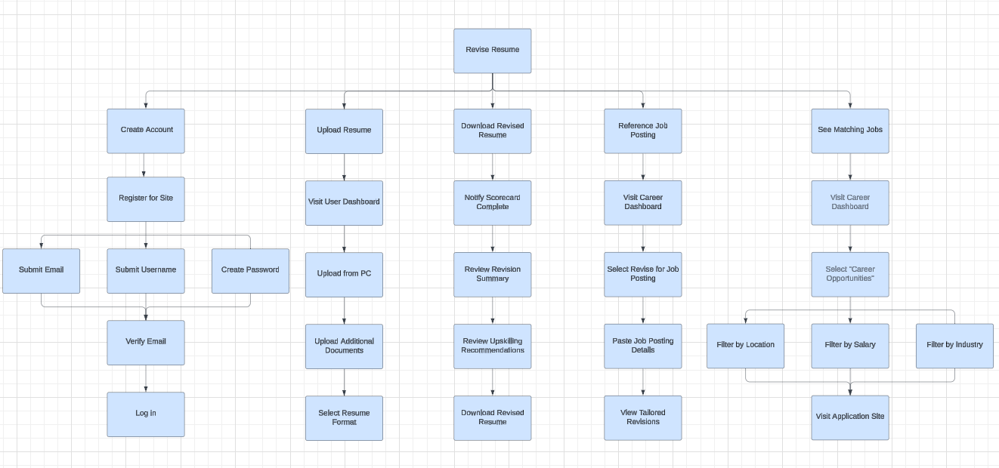
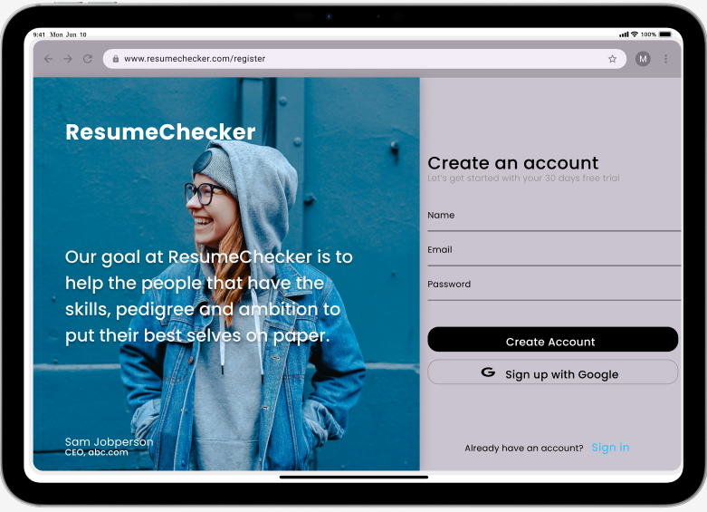
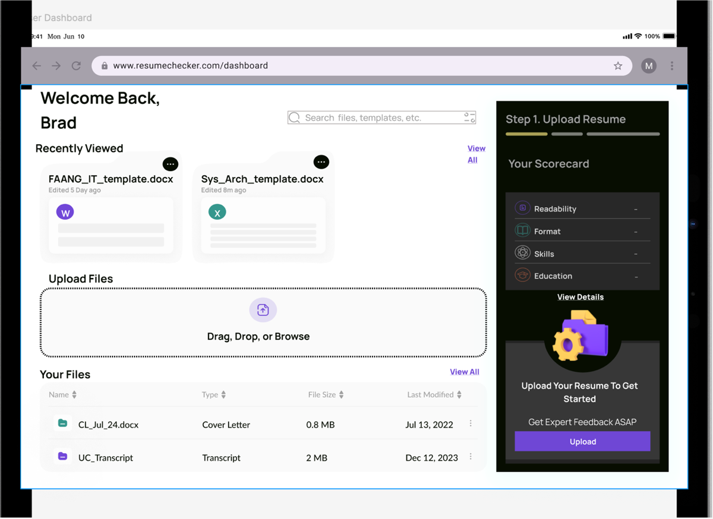
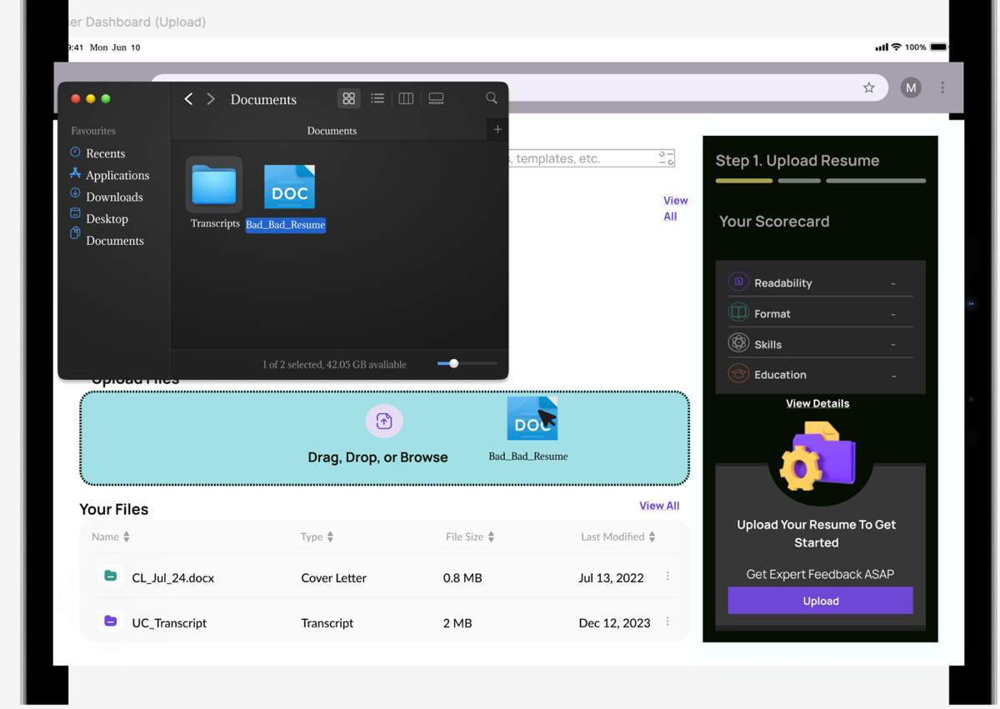

# ResumeChecker: UX Prototype & Usability Study

**Course:** Human Computer Interaction (IT 2021C) · **Term:** Summer 2026 · **Type:** Team project (4 members) · **Score:** 100/100

## Overview
Our team designed and built a medium-high fidelity prototype for **ResumeChecker**, a web application that helps job seekers improve their resumes with AI-powered feedback and scoring. We used a **Work Activity Affinity Diagram (WAAD)** to identify user needs, designed the prototype in **Figma**, and conducted a pilot usability test to validate it before the next round of evaluation.

## My Contributions
UI design decisions, screen flow, and documentation of the registration and account creation task.

## Tools
Figma · Hierarchical Task Inventory (HTI) · WAAD · Pilot usability testing

## Hierarchical Task Inventory
The HTI maps every user task from the top-level goal ("Revise Resume") down to individual actions. It was the foundation for deciding which two tasks to prototype: **Create Account** and **Upload Resume**.

## Prototype Screens

**Landing page:** shows user testimonials to build trust, with sign-in and register options. The sign-in uses a modal rather than a separate page to reduce steps for returning users.

**User dashboard:** after logging in, users see recently viewed files, an upload drop zone, and a scorecard panel that scores the resume on readability, format, skills, and education.

**Resume upload:** drag-and-drop file upload with file type and history management.

## Design Decisions
- **Modal for sign-in, full page for registration:** returning users get fewer steps; new users get a focused registration experience that doesn't interrupt the landing page.
- **Left navigation bar:** gives users immediate access to all features (dashboard, scorecard, uploads, templates, job postings) on every page, reducing navigation depth.
- **Testimonials on the landing page:** a direct response to WAAD feedback that new users need social proof before trusting the tool with their documents.
- **Email verification step:** shown as a simulation screen to document the full account creation flow, even though it happens outside the app.

## Pilot Test
A team member outside the design process walked through both tasks. The test confirmed the prototype was complete and functional for the two key flows, and the feedback led us to clarify navigation labels before the full usability evaluation.

## What I Learned
- How to move from raw user research (WAAD notes) to design decisions in a structured way
- How a Hierarchical Task Inventory helps scope a prototype to the right level of detail
- How modal vs. page-level interactions affect perceived complexity for different user types
- How to conduct and document a pilot usability test
