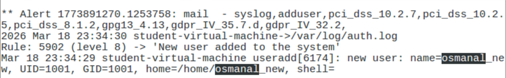
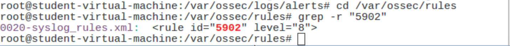
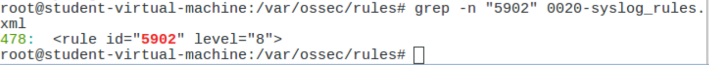

# OSSEC Alert-Rule Tracing

**Course:** Network Monitoring & IPS (IT 3075C) · **Term:** Spring 2026 · **Type:** Individual lab

## Overview
In this lab I generated a security event on a Linux host monitored by OSSEC, a host-based intrusion detection system (HIDS), then traced the resulting alert back to the exact detection rule that fired. This is the same workflow a SOC analyst uses to understand why an alert triggered and whether it matters.

## Tools & Technologies
OSSEC HIDS · Sguil · Ubuntu Linux · Bash (`grep`, `cat`, `sudo`) · `/var/log/auth.log`

## What I Did
- **Generated an event:** Created a new local user account with `useradd` and `adduser`, an action attackers often take to keep access to a compromised system.
- **Verified the change:** Confirmed the new account in `/etc/passwd` and `/etc/shadow`.
- **Triaged the alert in Sguil:** Spotted the new alert in the Sguil analyst console and determined its source. It came from the OSSEC agent on the host itself, not from network traffic on the sensor's monitoring interface, which makes it a host-based alert rather than a network-based one.
- **Found it in the logs:** Searched the OSSEC alert log (`/var/ossec/logs/alerts/alerts.log`) and located the matching alert, generated from `/var/log/auth.log`.
- **Identified the rule:** The alert fired **Rule 5902 (level 8): "New user added to the system."**
- **Traced it to the source:** Used `grep -r` to find the rule in `0020-syslog_rules.xml`, then `grep -n` to locate its definition on **line 478**.

## Results
OSSEC detected the account creation within about a second and tagged the alert with compliance mappings, including **PCI DSS 10.2.5, 10.2.7, and 8.1.2** and **GDPR Article 32**. This shows how one detection rule supports both security monitoring and regulatory audit requirements.

## What I Learned
- The difference between host-based and network-based detection, and how to tell which one produced an alert.
- How a HIDS turns raw system logs into prioritized alerts using rule IDs and severity levels.
- How to trace any alert back to its rule definition, which is the first step in tuning rules and reducing false positives.
- How detection rules map to compliance frameworks like PCI DSS and GDPR, connecting day-to-day monitoring with governance and audit work.

---
_All work performed on an isolated lab virtual machine. The user account shown was a test account created for this exercise._
