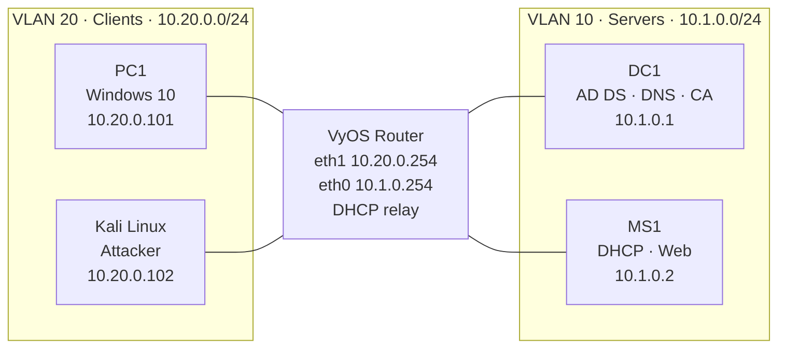

# Secure Network Architecture: VLAN Segmentation & MitM Testing

**Course:** Network Security (IT 3071C) · **Term:** Summer 2025 · **Type:** Individual lab

## Overview
In this lab I built a segmented network with VLANs and a VyOS router, configured core Windows services (Active Directory, DNS, DHCP, a certificate authority, and HTTPS), and then attacked my own network from a Kali Linux machine. The goal was to see how segmentation and encryption hold up against man-in-the-middle (MitM) attacks like ARP spoofing and HTTPS downgrade.

## Tools & Technologies
VyOS router · Hyper-V VLANs · Windows Server (AD DS, DNS, DHCP, AD Certificate Services, IIS) · Kali Linux · Ettercap · arpspoof · SSLstrip · Wireshark

## Network Design

| System | OS | IP Address | Role |
|---|---|---|---|
| DC1 | Windows Server | 10.1.0.1 | Domain controller, DNS, certificate authority |
| MS1 | Windows Server | 10.1.0.2 | DHCP server |
| PC1 | Windows 10 | 10.20.0.101 | Client workstation |
| RT1-LOCAL | VyOS | eth0 10.1.0.254 · eth1 10.20.0.254 | Router between VLANs |
| Kali | Kali Linux | 10.20.0.102 | Attack simulation |

## What I Did
- **Set up a certificate authority and HTTPS:** Configured AD Certificate Services, issued a domain certificate for `updates.corp.515support.com`, and bound it to the IIS website on port 443 with an HTTP-to-HTTPS redirect.
- **Segmented the network:** Placed servers in VLAN 10 and clients in VLAN 20, then configured the VyOS router with an interface in each subnet to route between them.
- **Configured a DHCP relay:** Set up the router to forward DHCP requests from the client VLAN to the DHCP server in the server VLAN, and created a new scope for the client subnet.
- **Joined the domain and verified DNS:** Pointed PC1 at the domain controller for DNS, joined it to the domain, and confirmed name resolution and HTTPS access.
- **Attacked the network:** From Kali, used Ettercap and arpspoof to poison ARP caches and reroute PC1's traffic through the attacker, then attempted an HTTPS downgrade with SSLstrip.
- **Analyzed the traffic:** Used Wireshark to confirm the interception and to check whether any credentials or application data were exposed.

## Troubleshooting
- **Certificate authority not listed:** The CA selection button was grayed out when requesting a certificate. I fixed it by correcting the common name and domain in the certificate's Distinguished Name.
- **Client not getting an IP address:** PC1 initially failed to get a DHCP lease across the VLANs. I traced it to the relay and interface configuration on the router, corrected the interface IPs, and PC1 began receiving addresses.

## Results
The ARP spoofing attack worked: Wireshark showed PC1's traffic flowing through the Kali machine. However, the HTTPS connection held up, and no login credentials or sensitive data were exposed in the capture. Segmentation limits who can reach critical servers, but it doesn't stop a rogue device inside the same VLAN, which is why encryption and endpoint controls are still needed.

## What I Learned
- How ARP spoofing works: the attacker sends forged ARP replies claiming to be the gateway or server, so victims send their traffic to the attacker instead.
- Why defense in depth matters. Segmentation, encryption, and endpoint security each cover gaps the others leave open.
- How to further control traffic between VLANs with access control lists (ACLs), firewall rules, and restricted inter-VLAN routing.
- How DHCP relay, DNS, certificates, and routing depend on each other, and how to troubleshoot them when one breaks.

---
_All work performed in an isolated virtual lab environment._
