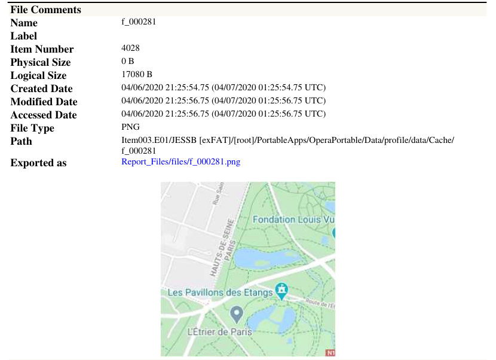
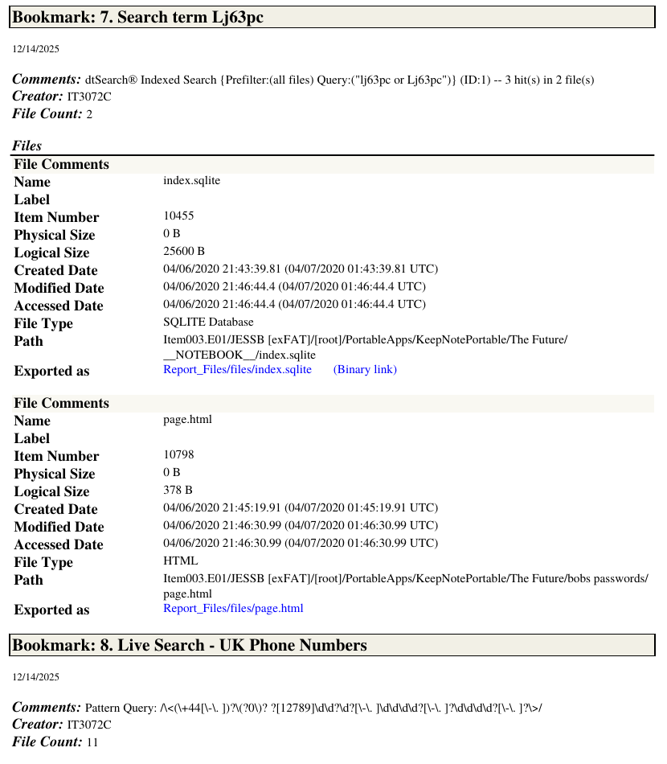

# USB Forensic Examination (FTK Final Project)

**Course:** Computer & Network Forensics (IT 3072C) · **Term:** Fall 2025 · **Type:** Individual final project

## Overview
For this final project I acted as the digital forensic examiner on a simulated criminal investigation. I received a forensic image of a 2 GB USB flash drive, verified its integrity, processed it in Forensic Toolkit (FTK), and examined it for artifacts requested in a service request from the case agent. The case, people, and evidence are fictional and were provided as course training data.

## Tools & Technologies
AccessData FTK 8.2 · FTK Imager · dtSearch indexed search · Regular expressions · MD5 / SHA-1 hashing · E01 forensic images

## What I Did
- **Verified evidence integrity:** Copied the E01 image to a dedicated case folder and ran FTK Imager hash verification **before** and **after** the examination. Both MD5 and SHA-1 matched the original acquisition hashes every time, proving the evidence was not altered.
- **Processed the evidence:** Created a new FTK case and processed the image, which contained **23,928 items** on an exFAT volume, including **772 deleted files** and **1,652 files with mismatched extensions**.
- **Examined and bookmarked artifacts** for each item in the service request:
  - A full directory and file listing of the drive
  - Word documents, including a zero-length file named *Final Plans.docx*
  - Browser bookmarks and search history from a portable Opera browser
  - **21 cached map images** recovered from the browser cache, showing areas of Paris, Berlin, and Munich
  - A check for previously deleted ZIP files (none found on the media)
  - An **indexed keyword search** that located the target term in 2 files inside a portable note-taking app
  - A **regular-expression search** for UK-format phone numbers across the whole image
- **Reported findings:** Generated a 30-page FTK case report with every bookmarked artifact, its full path, and its timestamps.

## Evidence Integrity Log
```
Evidence:  Item003.E01  (2 GB USB flash drive)
MD5:       20202b5e97c0cfb36dd41144f636ffc0
SHA-1:     b951094005f3b2b85a70fa49e3bfc437f175f67a

Original acquisition ......... verified
Pre-examination check ........ verified
Post-examination check ....... verified
```

## Results



## What I Learned
- Why hash verification before and after an exam is essential for chain of custody and for evidence to hold up in court.
- How to recover user activity from browser artifacts, including cached images that show what someone was looking at even when they never saved it.
- How to use indexed keyword searches and regular expressions to find specific evidence across tens of thousands of files.
- How to scope an examination to a service request and document every finding with its path and timestamps.

---
_All work performed on fictional training evidence in a lab environment._
