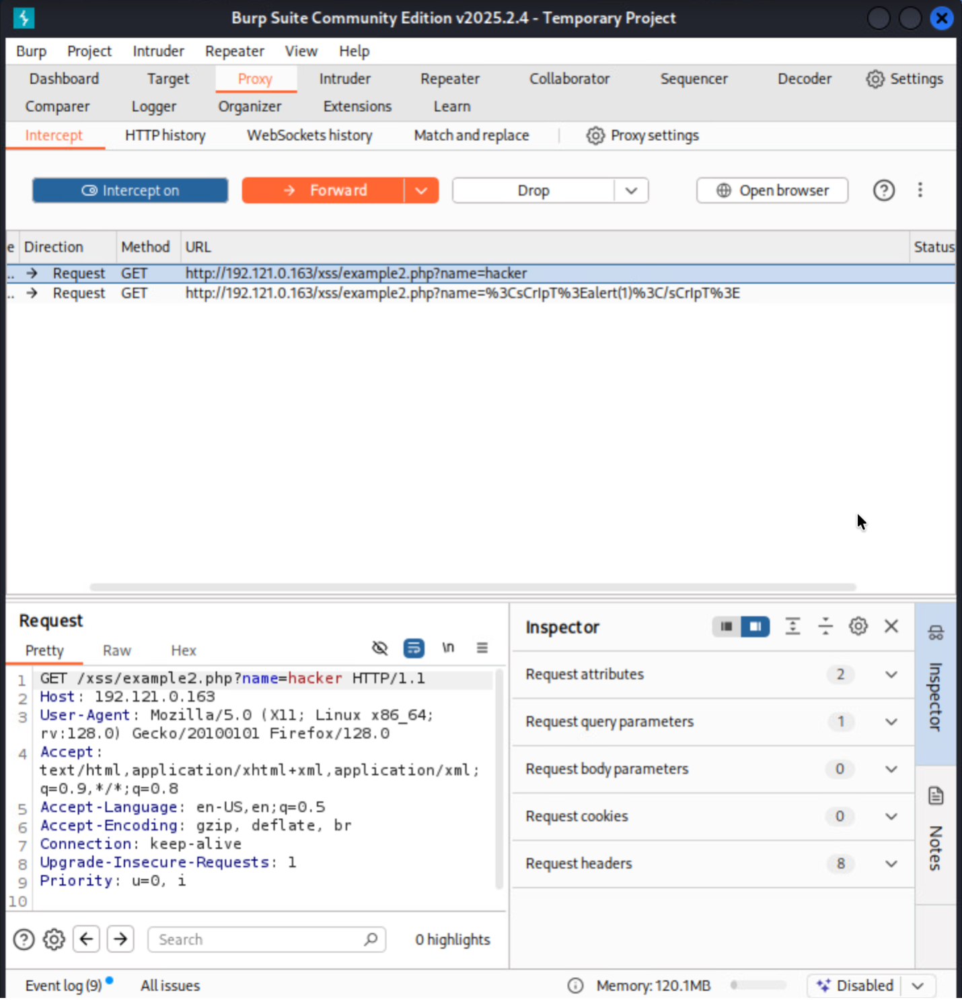
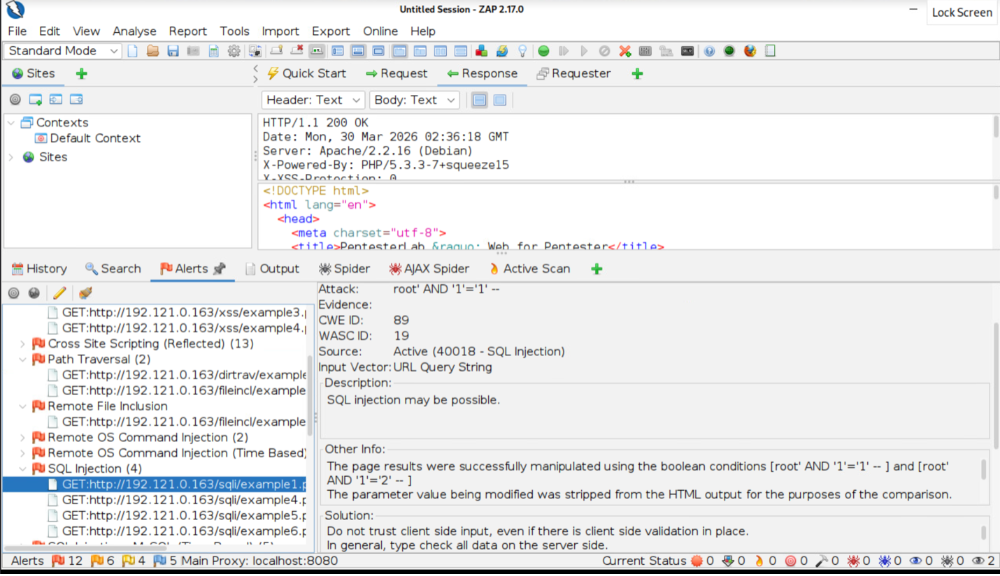
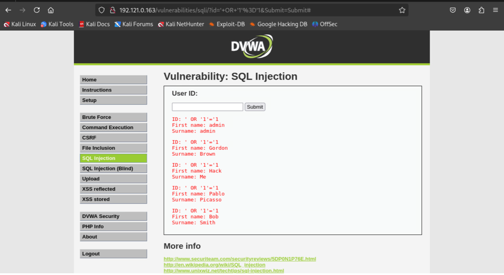

# Web Application Vulnerability Testing

**Course:** Penetration Testing (IT 4076C) · **Term:** Spring 2026 · **Type:** Individual lab

## Overview
In this lab I tested two intentionally vulnerable web applications, Web for Pentester and DVWA (Damn Vulnerable Web Application), for common web attacks. I worked in three ways: exploiting vulnerabilities manually in the browser, intercepting and modifying traffic with a proxy, and running an automated vulnerability scan, then compared what each approach revealed.

## Tools & Technologies
Kali Linux · Firefox · Burp Suite Community Edition · OWASP ZAP · Web for Pentester · DVWA

## What I Did
- **Manual exploitation:** Solved 20 web challenges by crafting malicious input, including 8 SQL injection, 7 cross-site scripting (XSS), 2 code injection, 2 command injection, and 1 LDAP injection.
- **Proxy interception:** Configured Firefox to route traffic through Burp Suite, then intercepted and edited live HTTP requests to carry out 5 attacks (SQL injection, XSS, command injection, and LDAP injection).
- **Automated scanning:** Ran an OWASP ZAP active scan and analyzed its high-risk alerts, explaining how ZAP detected XSS, path traversal, remote file inclusion, SQL injection, and server-side code injection.
- **DVWA challenges:** Used command execution to read `/etc/passwd`, used SQL injection to return every user in the database, and triggered both reflected and stored XSS.

## Results
Every targeted vulnerability was successfully exploited. The ZAP scan confirmed the same core weakness behind the manual findings: the applications trusted user input without validating or sanitizing it.

## What I Learned
- How injection and XSS attacks work, and why input validation, parameterized queries, and output encoding are the main defenses against them.
- How to use an intercepting proxy to see and manipulate the traffic between a browser and a server.
- The strengths and limits of automated scanners compared with manual testing, and why a tester needs to verify and understand scanner results instead of just reporting them.

---
_All testing was performed on intentionally vulnerable applications in an isolated, authorized lab environment for educational purposes._
